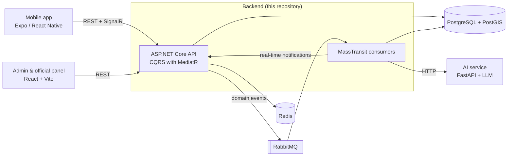

# Urban Community — Backend API

[](https://github.com/berkanserbes/urban-community-backend/actions/workflows/ci.yml)


[](LICENSE)

**English** | [Türkçe](README.tr.md)

Urban Community is an AI-assisted platform for reporting and resolving urban issues. Citizens report
problems such as broken street lights or water leaks from a mobile app. An AI service categorizes each
report, scores its priority and detects duplicates. The report is then routed to the responsible
municipal department, where officials track it to resolution in a web panel. Citizens can also share
suggestions, vote on them and help each other through neighborhood community posts.

This repository contains the ASP.NET Core API, the event-driven background processing and the local
orchestration (Docker Compose and .NET Aspire).

## Repositories

| Repository | Description |
| --- | --- |
| **[urban-community-backend](https://github.com/berkanserbes/urban-community-backend)** | ASP.NET Core API, RabbitMQ consumers, PostgreSQL/PostGIS (this repository) |
| [urban-community-ai-service](https://github.com/berkanserbes/urban-community-ai-service) | FastAPI service for categorization, priority scoring and duplicate detection |
| [urban-community-management-web](https://github.com/berkanserbes/urban-community-management-web) | React admin and official panel |
| [urban-community-mobile](https://github.com/berkanserbes/urban-community-mobile) | Expo / React Native citizen app |

## Architecture



The solution follows Clean Architecture:

| Project | Responsibility |
| --- | --- |
| `UrbanCommunity.Domain` | Entities, enums and domain rules such as the report status workflow |
| `UrbanCommunity.Application` | CQRS commands and queries (MediatR), validation and caching pipeline behaviors |
| `UrbanCommunity.Infrastructure` | EF Core persistence, migrations, MassTransit consumers, AI client, file storage, Identity |
| `UrbanCommunity.Api` | Controllers, middleware, SignalR hub, OpenAPI, authentication and rate limiting |
| `UrbanCommunity.AppHost` | .NET Aspire orchestration for local development |
| `UrbanCommunity.ServiceDefaults` | OpenTelemetry, service discovery and health endpoints |

### Report lifecycle

1. A citizen creates a report with photos and an optional GPS location. The API saves it in
   `AiReview` status and returns immediately.
2. A `ReportAiReviewRequested` event goes through RabbitMQ. Its consumer asks the AI service for a
   category, compares the report with recent nearby open reports for duplicates and requests a
   priority score.
3. The category routes the report to the department that handles it within the matching province,
   district or neighborhood jurisdiction.
4. Officials move the report through `PendingReview → Confirmed → InProgress → Resolved` (or
   `Rejected`). Every change is stored in the report history and notifies the citizen in real time.

Transient AI failures are retried by MassTransit. If retries run out, a fault consumer completes the
review with default values so that no report stays in `AiReview`.

Messaging uses the MassTransit transactional outbox. Events are saved in the same database transaction
as the change that raised them and sent to RabbitMQ after the commit, so a broker outage cannot lose
them. On the consumer side the inbox records every message id, so a redelivered message is not
processed twice (for example, no duplicate notifications).

## Features

- **Reports:** photo uploads, optional location (PostGIS), AI categorization, priority and duplicate
  detection, department routing, status workflow with history, comments.
- **Role-based access:** Citizen, Official and Admin. An official only manages reports of their own
  department inside their jurisdiction (province, district or neighborhood).
- **Suggestions:** up and down votes with row-locked score updates, status workflow, official responses.
- **Community posts:** help requests, tool borrowing and lost & found posts, scoped to a neighborhood,
  district or province.
- **Announcements:** location-scoped announcements with an expiry date.
- **Notifications:** persisted notifications delivered in real time through SignalR.
- **Administration:** organizations, departments, categories, official accounts and audit logs.
- **API conventions:** a common pagination contract, server-side filters and stats endpoints
  (see [docs/Pagination.md](docs/Pagination.md)).

## Engineering highlights

- Clean Architecture with CQRS (MediatR) and pipeline behaviors for validation (FluentValidation) and caching.
- Event-driven processing with MassTransit and RabbitMQ: transactional outbox, idempotent consumers
  (inbox), retries and a fault consumer.
- Redis distributed cache with an automatic in-memory fallback.
- JWT authentication with refresh-token rotation and rate limiting on authentication endpoints.
- Offset pagination translated to SQL, with composite indexes for every paged sort order.
- Structured logging with Serilog, tracing and metrics with OpenTelemetry, and health checks for
  PostgreSQL, Redis, RabbitMQ and the AI service.
- 185 xUnit tests, including HTTP integration tests and tests that verify the queries translate to
  PostgreSQL SQL. They run on every push and pull request in GitHub Actions.

## Tech stack

| Area | Technologies |
| --- | --- |
| Runtime | .NET 10, ASP.NET Core |
| Data | PostgreSQL, PostGIS (NetTopologySuite), Entity Framework Core 10 |
| Messaging | RabbitMQ, MassTransit |
| Caching | Redis (StackExchange.Redis), in-memory fallback |
| Real time | SignalR |
| Auth | ASP.NET Core Identity, JWT bearer tokens |
| Application | MediatR, FluentValidation |
| Observability | Serilog, OpenTelemetry, .NET Aspire dashboard |
| API docs | OpenAPI, Scalar |
| File storage | Local disk or Cloudinary |
| Testing | xUnit, ASP.NET Core TestHost, EF Core InMemory and SQLite |

## Getting started

### Prerequisites

- [.NET 10 SDK](https://dotnet.microsoft.com/download)
- [Docker](https://www.docker.com/)
- An API key for one LLM provider (OpenAI, Gemini or DeepSeek) for the AI service

### Clone the repositories

Docker Compose builds the AI service from a sibling folder, so clone both repositories side by side
with these folder names:

```bash
mkdir urban-community && cd urban-community
git clone https://github.com/berkanserbes/urban-community-backend.git backend
git clone https://github.com/berkanserbes/urban-community-ai-service.git ai
```

### Configure

```bash
cd backend
cp src/UrbanCommunity.Api/.env.example src/UrbanCommunity.Api/.env.development
```

Fill in the values in `.env.development`: database credentials, `JWT_SECRET`, `AI_API_KEY`, the LLM
provider key and, optionally, the `DEV_ADMIN_*` account. Environment files are gitignored.

### Option A: Docker Compose

```bash
docker compose -f src/docker/docker-compose.yaml \
  --env-file src/UrbanCommunity.Api/.env.development up -d --build
```

This starts PostgreSQL/PostGIS, pgAdmin, RabbitMQ, Redis, the AI service and the API. The API listens
on `http://localhost:5000`.

### Option B: .NET Aspire

Build the AI image once, then start the AppHost:

```bash
docker build -t urban-community-ai ../ai
dotnet run --project src/UrbanCommunity.AppHost
```

The Aspire dashboard at `http://localhost:18888` shows logs, traces and metrics for every service.

### Explore the API

In the `Development` environment the interactive API reference is available at
`http://localhost:5000/scalar/v1`.

On startup the API applies migrations and seeds report categories and the province, district and
neighborhood data. If `DEV_ADMIN_EMAIL` and `DEV_ADMIN_PASSWORD` are set, it also creates a
development admin account.

## Tests

```bash
dotnet test tests/UrbanCommunity.Infrastructure.Tests/UrbanCommunity.Infrastructure.Tests.csproj
```

Most tests use EF Core InMemory and SQLite databases and an in-process test server. The messaging
tests start PostgreSQL with PostGIS in Docker through Testcontainers, so Docker must be running.

## Documentation

- [docs/Pagination.md](docs/Pagination.md): pagination contract, filters and stats endpoints (Turkish)
- [docs/DatabaseSchema.md](docs/DatabaseSchema.md): tables, relations and indexes (Turkish)

## License

This project is licensed under the [MIT License](LICENSE).
