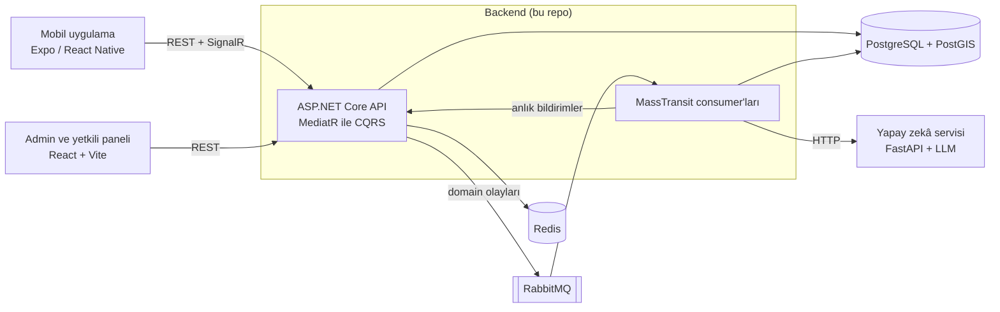

# Urban Community — Backend API

[](https://github.com/berkanserbes/urban-community-backend/actions/workflows/ci.yml)


[](LICENSE)

[English](README.md) | **Türkçe**

Urban Community, kentsel sorunların bildirilmesi ve çözülmesi için yapay zekâ destekli bir platformdur.
Vatandaşlar bozuk sokak lambası, su kaçağı gibi sorunları mobil uygulamadan bildirir. Bir yapay zekâ
servisi her raporu kategorilendirir, önceliğini belirler ve benzer raporları tespit eder. Rapor daha
sonra ilgili belediye birimine yönlendirilir ve yetkililer çözülene kadar web panelinden takip eder.
Vatandaşlar ayrıca öneri paylaşabilir, önerilere oy verebilir ve mahalle topluluk gönderileriyle
birbirine yardım edebilir.

Bu repo ASP.NET Core API'yi, olay tabanlı arka plan işlemlerini ve lokal orkestrasyonu (Docker Compose
ve .NET Aspire) içerir.

## Repolar

| Repo | Açıklama |
| --- | --- |
| **[urban-community-backend](https://github.com/berkanserbes/urban-community-backend)** | ASP.NET Core API, RabbitMQ consumer'ları, PostgreSQL/PostGIS (bu repo) |
| [urban-community-ai-service](https://github.com/berkanserbes/urban-community-ai-service) | Kategorilendirme, önceliklendirme ve benzer rapor tespiti için FastAPI servisi |
| [urban-community-management-web](https://github.com/berkanserbes/urban-community-management-web) | React admin ve yetkili paneli |
| [urban-community-mobile](https://github.com/berkanserbes/urban-community-mobile) | Expo / React Native vatandaş uygulaması |

## Mimari



Çözüm Clean Architecture yapısını izler:

| Proje | Sorumluluk |
| --- | --- |
| `UrbanCommunity.Domain` | Entity'ler, enum'lar ve rapor durum akışı gibi domain kuralları |
| `UrbanCommunity.Application` | CQRS command ve query'leri (MediatR), doğrulama ve cache pipeline davranışları |
| `UrbanCommunity.Infrastructure` | EF Core kalıcılık katmanı, migration'lar, MassTransit consumer'ları, yapay zekâ istemcisi, dosya depolama, Identity |
| `UrbanCommunity.Api` | Controller'lar, middleware, SignalR hub, OpenAPI, kimlik doğrulama ve rate limiting |
| `UrbanCommunity.AppHost` | Lokal geliştirme için .NET Aspire orkestrasyonu |
| `UrbanCommunity.ServiceDefaults` | OpenTelemetry, service discovery ve health endpoint'leri |

### Rapor yaşam döngüsü

1. Vatandaş fotoğraflı ve isteğe bağlı GPS konumlu bir rapor oluşturur. API raporu `AiReview`
   durumunda kaydeder ve hemen yanıt döner.
2. `ReportAiReviewRequested` olayı RabbitMQ üzerinden iletilir. Consumer'ı yapay zekâ servisinden
   kategori ister, raporu yakındaki güncel açık raporlarla karşılaştırıp benzerlerini bulur ve bir
   öncelik puanı alır.
3. Kategori, raporu ilgili il, ilçe veya mahalle yetki alanında o işe bakan birime yönlendirir.
4. Yetkililer raporu `PendingReview → Confirmed → InProgress → Resolved` (veya `Rejected`) adımlarından
   geçirir. Her değişiklik rapor geçmişine kaydedilir ve vatandaşa anlık bildirim olarak gider.

Geçici yapay zekâ hatalarını MassTransit yeniden dener. Denemeler tükenirse bir fault consumer
incelemeyi varsayılan değerlerle tamamlar; böylece hiçbir rapor `AiReview` durumunda kalmaz.

Mesajlaşmada MassTransit transactional outbox kullanılır. Olaylar, onları doğuran değişiklikle aynı
veritabanı transaction'ında kaydedilir ve commit'ten sonra RabbitMQ'ya gönderilir; böylece broker
kesintisinde kaybolmaz. Consumer tarafında inbox her mesajın kimliğini tutar; tekrar teslim edilen
bir mesaj ikinci kez işlenmez (örneğin çift bildirim oluşmaz).

## Özellikler

- **Raporlar:** fotoğraf yükleme, isteğe bağlı konum (PostGIS), yapay zekâ ile kategori, öncelik ve
  benzer rapor tespiti, birime yönlendirme, geçmişi tutulan durum akışı, yorumlar.
- **Rol bazlı erişim:** Citizen (vatandaş), Official (yetkili) ve Admin. Bir yetkili yalnızca kendi
  biriminin, kendi yetki alanındaki (il, ilçe veya mahalle) raporlarını yönetir.
- **Öneriler:** satır kilidiyle güncellenen artı/eksi oylar, durum akışı, yetkili yanıtları.
- **Topluluk gönderileri:** yardım talebi, alet ödünç alma ve kayıp eşya gönderileri; mahalle, ilçe
  veya il kapsamında.
- **Duyurular:** konuma göre hedeflenen, son kullanma tarihi olan duyurular.
- **Bildirimler:** veritabanında saklanan ve SignalR ile anlık iletilen bildirimler.
- **Yönetim:** kurumlar, birimler, kategoriler, yetkili hesapları ve denetim kayıtları (audit log).
- **API standartları:** ortak sayfalama sözleşmesi, sunucu tarafı filtreler ve istatistik
  endpoint'leri (bkz. [docs/Pagination.md](docs/Pagination.md)).

## Öne çıkan mühendislik çözümleri

- MediatR ile CQRS uygulanan Clean Architecture; doğrulama (FluentValidation) ve cache için pipeline davranışları.
- MassTransit ve RabbitMQ ile olay tabanlı işleme: transactional outbox, tekrar teslime dayanıklı
  (idempotent) consumer'lar (inbox), yeniden deneme ve fault consumer.
- Redis dağıtık cache ve otomatik in-memory yedeği.
- Refresh token rotasyonlu JWT kimlik doğrulama ve kimlik doğrulama endpoint'lerinde rate limiting.
- SQL'e çevrilen offset sayfalama ve her sayfalı sıralama için bileşik index'ler.
- Serilog ile yapılandırılmış loglama, OpenTelemetry ile trace ve metrikler; PostgreSQL, Redis,
  RabbitMQ ve yapay zekâ servisi için health check'ler.
- HTTP integration testleri ve sorguların PostgreSQL SQL'ine çevrildiğini doğrulayan testler dahil
  185 xUnit testi. Her push ve pull request'te GitHub Actions'ta çalışır.

## Teknolojiler

| Alan | Teknolojiler |
| --- | --- |
| Çalışma ortamı | .NET 10, ASP.NET Core |
| Veri | PostgreSQL, PostGIS (NetTopologySuite), Entity Framework Core 10 |
| Mesajlaşma | RabbitMQ, MassTransit |
| Cache | Redis (StackExchange.Redis), in-memory yedek |
| Anlık iletişim | SignalR |
| Kimlik doğrulama | ASP.NET Core Identity, JWT bearer token |
| Uygulama katmanı | MediatR, FluentValidation |
| Gözlemlenebilirlik | Serilog, OpenTelemetry, .NET Aspire dashboard |
| API dokümantasyonu | OpenAPI, Scalar |
| Dosya depolama | Lokal disk veya Cloudinary |
| Test | xUnit, ASP.NET Core TestHost, EF Core InMemory ve SQLite |

## Başlangıç

### Gereksinimler

- [.NET 10 SDK](https://dotnet.microsoft.com/download)
- [Docker](https://www.docker.com/)
- Yapay zekâ servisi için bir LLM sağlayıcısının (OpenAI, Gemini veya DeepSeek) API anahtarı

### Repoları klonlama

Docker Compose yapay zekâ servisini yan klasörden derler. Bu yüzden iki repoyu aynı klasörün altına,
şu klasör adlarıyla klonlayın:

```bash
mkdir urban-community && cd urban-community
git clone https://github.com/berkanserbes/urban-community-backend.git backend
git clone https://github.com/berkanserbes/urban-community-ai-service.git ai
```

### Yapılandırma

```bash
cd backend
cp src/UrbanCommunity.Api/.env.example src/UrbanCommunity.Api/.env.development
```

`.env.development` içindeki değerleri doldurun: veritabanı bilgileri, `JWT_SECRET`, `AI_API_KEY`, LLM
sağlayıcı anahtarı ve isteğe bağlı olarak `DEV_ADMIN_*` hesabı. Ortam dosyaları `.gitignore`'dadır.

### Seçenek A: Docker Compose

```bash
docker compose -f src/docker/docker-compose.yaml \
  --env-file src/UrbanCommunity.Api/.env.development up -d --build
```

Bu komut PostgreSQL/PostGIS, pgAdmin, RabbitMQ, Redis, yapay zekâ servisi ve API'yi başlatır. API
`http://localhost:5000` adresinde çalışır.

### Seçenek B: .NET Aspire

Yapay zekâ imajını bir kez derleyin, sonra AppHost'u başlatın:

```bash
docker build -t urban-community-ai ../ai
dotnet run --project src/UrbanCommunity.AppHost
```

`http://localhost:18888` adresindeki Aspire dashboard tüm servislerin loglarını, trace'lerini ve
metriklerini gösterir.

### API'yi keşfetme

`Development` ortamında etkileşimli API dokümantasyonu `http://localhost:5000/scalar/v1` adresindedir.

API açılışta migration'ları uygular; rapor kategorilerini ve il, ilçe, mahalle verilerini yükler.
`DEV_ADMIN_EMAIL` ve `DEV_ADMIN_PASSWORD` tanımlıysa bir geliştirme admin hesabı da oluşturur.

## Testler

```bash
dotnet test tests/UrbanCommunity.Infrastructure.Tests/UrbanCommunity.Infrastructure.Tests.csproj
```

Testlerin çoğu EF Core InMemory ve SQLite veritabanlarıyla, uygulama içi bir test sunucusu kullanır.
Mesajlaşma testleri Testcontainers ile Docker'da PostGIS'li PostgreSQL başlatır; bu yüzden Docker
çalışıyor olmalıdır.

## Dokümantasyon

- [docs/Pagination.md](docs/Pagination.md): sayfalama sözleşmesi, filtreler ve istatistik endpoint'leri
- [docs/DatabaseSchema.md](docs/DatabaseSchema.md): tablolar, ilişkiler ve index'ler

## Lisans

Bu proje [MIT Lisansı](LICENSE) ile lisanslanmıştır.
