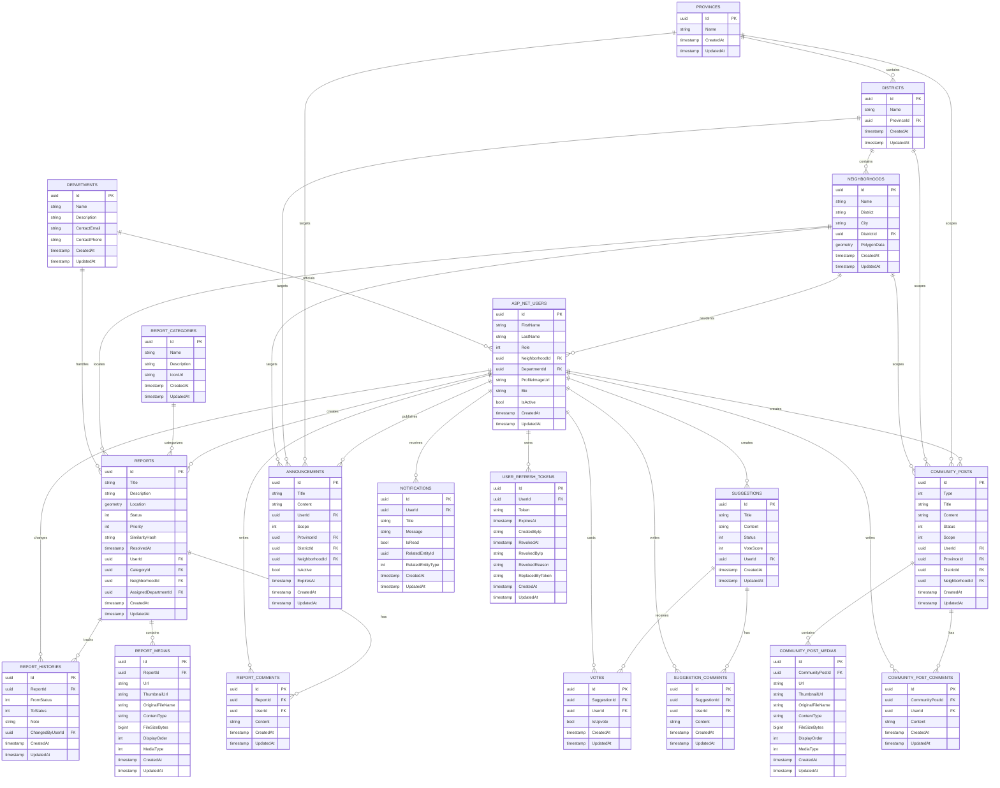

# Database Schema

Bu dokuman, UrbanCommunity backend projesindeki guncel Entity Framework Core modelini ozetler. Kaynak olarak `ApplicationDbContext`, domain entity siniflari ve `Persistence/Configurations` altindaki EF Core configuration siniflari dikkate alinmistir.

## Genel Notlar

- Veritabani provider'i PostgreSQL'dir.
- Konumsal alanlar icin PostGIS ve NetTopologySuite kullanilir.
- Identity altyapisi `IdentityDbContext<User, IdentityRole<Guid>, Guid>` uzerinden calisir.
- `User` entity'si Identity kullanici tablosunu genisletir ve veritabaninda `AspNetUsers` tablosuna karsilik gelir.
- `BaseEntity` kullanan domain tablolarinda ortak alanlar bulunur: `Id`, `CreatedAt`, `UpdatedAt`.
- Enum alanlari veritabaninda numeric deger olarak saklanir.

## Tablolar

Uygulama DbSet'leri:

| DbSet | Tablo | Aciklama |
| --- | --- | --- |
| `Users` | `AspNetUsers` | Identity kullanicilari ve domain profil alanlari |
| `Provinces` | `Provinces` | Il bilgileri |
| `Districts` | `Districts` | Ilce bilgileri |
| `Neighborhoods` | `Neighborhoods` | Mahalle bilgileri ve opsiyonel polygon verisi |
| `Departments` | `Departments` | Belediye/kurum birimleri |
| `ReportCategories` | `ReportCategories` | Rapor kategori bilgileri |
| `Reports` | `Reports` | Vatandas sorun raporlari |
| `ReportMedias` | `ReportMedias` | Rapor medya dosyalari |
| `ReportHistories` | `ReportHistories` | Rapor durum gecmisleri |
| `ReportComments` | `ReportComments` | Rapor yorumlari |
| `Suggestions` | `Suggestions` | Vatandas onerileri |
| `Votes` | `Votes` | Oneri oylari |
| `SuggestionComments` | `SuggestionComments` | Oneri yorumlari |
| `CommunityPosts` | `CommunityPosts` | Topluluk gonderileri |
| `CommunityPostMedias` | `CommunityPostMedias` | Topluluk gonderisi medya dosyalari |
| `CommunityPostComments` | `CommunityPostComments` | Topluluk gonderisi yorumlari |
| `Announcements` | `Announcements` | Admin/official duyurulari |
| `Notifications` | `Notifications` | Kullanici bildirimleri |
| `UserRefreshTokens` | `UserRefreshTokens` | Refresh token kayitlari |

Identity tarafinda ayrica `AspNetRoles`, `AspNetUserRoles`, `AspNetUserClaims`, `AspNetRoleClaims`, `AspNetUserLogins`, `AspNetUserTokens` tablolari olusur.

## ER Diyagrami

## Ortak Alanlar

`BaseEntity` kullanan tablolarda:

| Alan | Tip | Zorunlu | Aciklama |
| --- | --- | --- | --- |
| `Id` | `Guid` | Evet | Primary key |
| `CreatedAt` | `DateTime` | Evet | Kayit olusturma zamani |
| `UpdatedAt` | `DateTime?` | Hayir | Son guncelleme zamani |

`AspNetUsers` Identity'den geldigi icin `BaseEntity` kullanmaz; fakat domain tarafinda `CreatedAt` ve `UpdatedAt` alanlari ayrica vardir.

## Lokasyon

### Provinces

Il tablosudur.

| Alan | Tip | Zorunlu | Aciklama |
| --- | --- | --- | --- |
| `Id` | `Guid` | Evet | PK |
| `Name` | `string` | Evet | Il adi |

Iliskiler:
- `Province 1 - N District`
- `Province 1 - N CommunityPost`
- `Province 1 - N Announcement`

### Districts

Ilce tablosudur.

| Alan | Tip | Zorunlu | Aciklama |
| --- | --- | --- | --- |
| `Id` | `Guid` | Evet | PK |
| `Name` | `string` | Evet | Ilce adi |
| `ProvinceId` | `Guid` | Evet | FK -> `Provinces.Id` |

Iliskiler:
- `District N - 1 Province`
- `District 1 - N Neighborhood`
- `District 1 - N CommunityPost`
- `District 1 - N Announcement`

### Neighborhoods

Mahalle tablosudur. Hem eski metinsel `City/District` alanlarini hem de yeni hiyerarsik `DistrictId` iliskisini tasir.

| Alan | Tip | Zorunlu | Aciklama |
| --- | --- | --- | --- |
| `Id` | `Guid` | Evet | PK |
| `Name` | `string(100)` | Evet | Mahalle adi |
| `District` | `string(100)` | Evet | Eski/metinsel ilce adi |
| `City` | `string(50)` | Evet | Eski/metinsel il adi |
| `DistrictId` | `Guid?` | Hayir | FK -> `Districts.Id` |
| `PolygonData` | `geometry?` | Hayir | PostGIS mahalle siniri |

Iliskiler:
- `Neighborhood N - 1 District`
- `Neighborhood 1 - N User`
- `Neighborhood 1 - N Report`
- `Neighborhood 1 - N CommunityPost`
- `Neighborhood 1 - N Announcement`

Indexler:
- Unique: `City + District + Name`

## Kullanici ve Yetkilendirme

### AspNetUsers

Identity kullanici tablosudur. Domain `User` sinifi bu tabloyu genisletir.

| Alan | Tip | Zorunlu | Aciklama |
| --- | --- | --- | --- |
| `Id` | `Guid` | Evet | PK |
| `FirstName` | `string(50)` | Evet | Ad |
| `LastName` | `string(50)` | Evet | Soyad |
| `Email` | `string?` | Hayir | Identity email |
| `UserName` | `string?` | Hayir | Identity username |
| `PasswordHash` | `string?` | Hayir | Identity password hash |
| `Role` | `UserRole` | Evet | `Citizen`, `Official`, `Admin` |
| `NeighborhoodId` | `Guid?` | Hayir | FK -> `Neighborhoods.Id` |
| `DepartmentId` | `Guid?` | Hayir | FK -> `Departments.Id` |
| `ProfileImageUrl` | `string(500)?` | Hayir | Profil gorseli |
| `Bio` | `string(300)?` | Hayir | Profil aciklamasi |
| `IsActive` | `bool` | Evet | Default `true` |
| `CreatedAt` | `DateTime` | Evet | Kayit zamani |
| `UpdatedAt` | `DateTime?` | Hayir | Son guncelleme |

Kurallar:
- `DepartmentId` yalnizca `Official` rolu icin anlamlidir.
- `CK_AspNetUsers_Department_Only_For_Officials` check constraint'i, department atamasini role gore korur.

Indexler:
- `Role`
- `IsActive`
- `DepartmentId`
- `NeighborhoodId`

### UserRefreshTokens

Refresh token rotasyonu ve iptal bilgilerini tutar.

| Alan | Tip | Zorunlu | Aciklama |
| --- | --- | --- | --- |
| `Id` | `Guid` | Evet | PK |
| `UserId` | `Guid` | Evet | FK -> `AspNetUsers.Id` |
| `Token` | `string(512)` | Evet | Refresh token |
| `ExpiresAt` | `DateTime` | Evet | Gecerlilik bitisi |
| `CreatedByIp` | `string(64)?` | Hayir | Olusturan IP |
| `RevokedAt` | `DateTime?` | Hayir | Iptal zamani |
| `RevokedByIp` | `string(64)?` | Hayir | Iptal eden IP |
| `RevokedReason` | `string(512)?` | Hayir | Iptal nedeni |
| `ReplacedByToken` | `string?` | Hayir | Rotasyon sonrasi token referansi |

Iliskiler:
- `UserRefreshToken N - 1 AspNetUser`

## Organizasyon

### Departments

Kurum/belediye birimlerini tutar.

| Alan | Tip | Zorunlu | Aciklama |
| --- | --- | --- | --- |
| `Id` | `Guid` | Evet | PK |
| `Name` | `string(150)` | Evet | Birim adi |
| `Description` | `string(500)?` | Hayir | Aciklama |
| `ContactEmail` | `string(100)?` | Hayir | Iletisim email |
| `ContactPhone` | `string(20)?` | Hayir | Iletisim telefonu |

Iliskiler:
- `Department 1 - N User`
- `Department 1 - N Report`

Indexler:
- Unique: `Name`

## Raporlama Modulu

### ReportCategories

Rapor kategorilerini tutar.

| Alan | Tip | Zorunlu | Aciklama |
| --- | --- | --- | --- |
| `Id` | `Guid` | Evet | PK |
| `Name` | `string(50)` | Evet | Kategori adi |
| `Description` | `string(250)?` | Hayir | Aciklama |
| `IconUrl` | `string(500)?` | Hayir | Ikon URL |

Iliskiler:
- `ReportCategory 1 - N Report`

### Reports

Vatandas tarafindan olusturulan sorun raporlarini tutar.

| Alan | Tip | Zorunlu | Aciklama |
| --- | --- | --- | --- |
| `Id` | `Guid` | Evet | PK |
| `Title` | `string(150)` | Evet | Baslik |
| `Description` | `string(1000)` | Evet | Aciklama |
| `Location` | `geometry(Point)` | Evet | PostGIS nokta konumu |
| `Status` | `ReportStatus` | Evet | Default `Pending` |
| `Priority` | `ReportPriority` | Evet | Default `Medium` |
| `SimilarityHash` | `string(256)?` | Hayir | AI/mukerrer kontrol hash'i |
| `ResolvedAt` | `DateTime?` | Hayir | Cozulme zamani |
| `UserId` | `Guid` | Evet | FK -> `AspNetUsers.Id` |
| `CategoryId` | `Guid` | Evet | FK -> `ReportCategories.Id` |
| `NeighborhoodId` | `Guid` | Evet | FK -> `Neighborhoods.Id` |
| `AssignedDepartmentId` | `Guid?` | Hayir | FK -> `Departments.Id` |

Iliskiler:
- `Report N - 1 User`
- `Report N - 1 ReportCategory`
- `Report N - 1 Neighborhood`
- `Report N - 1 Department`
- `Report 1 - N ReportMedia`
- `Report 1 - N ReportHistory`
- `Report 1 - N ReportComment`

Check constraint:
- `CK_Reports_ResolvedAt_Required_When_Resolved`: status `Resolved` ise `ResolvedAt` dolu olmalidir.

Indexler:
- `Status`
- `Priority`
- `NeighborhoodId + Status`
- Spatial index: `Location`

### ReportMedias

Raporlara bagli medya dosyalarini tutar.

| Alan | Tip | Zorunlu | Aciklama |
| --- | --- | --- | --- |
| `Id` | `Guid` | Evet | PK |
| `ReportId` | `Guid` | Evet | FK -> `Reports.Id` |
| `Url` | `string(500)` | Evet | Medya URL |
| `ThumbnailUrl` | `string(500)?` | Hayir | Thumbnail URL |
| `OriginalFileName` | `string(255)?` | Hayir | Orijinal dosya adi |
| `ContentType` | `string(100)?` | Hayir | MIME type |
| `FileSizeBytes` | `long?` | Hayir | Dosya boyutu |
| `DisplayOrder` | `int` | Evet | Default `0` |
| `MediaType` | `MediaType` | Evet | `Image`, `Video` |

Check constraint:
- `CK_ReportMedias_FileSize_Positive`: `FileSizeBytes` null veya pozitif olmali.
- `CK_ReportMedias_DisplayOrder_NonNegative`: `DisplayOrder >= 0`.

Indexler:
- `ReportId + DisplayOrder`

### ReportHistories

Rapor status degisikliklerini takip eder.

| Alan | Tip | Zorunlu | Aciklama |
| --- | --- | --- | --- |
| `Id` | `Guid` | Evet | PK |
| `ReportId` | `Guid` | Evet | FK -> `Reports.Id` |
| `FromStatus` | `ReportStatus` | Evet | Onceki status |
| `ToStatus` | `ReportStatus` | Evet | Yeni status |
| `Note` | `string(500)?` | Hayir | Degisiklik notu |
| `ChangedByUserId` | `Guid?` | Hayir | FK -> `AspNetUsers.Id` |

Check constraint:
- `CK_ReportHistories_StatusChange_IsRequired`: `FromStatus <> ToStatus`.

Indexler:
- `ReportId + CreatedAt`

### ReportComments

Rapor yorumlarini tutar.

| Alan | Tip | Zorunlu | Aciklama |
| --- | --- | --- | --- |
| `Id` | `Guid` | Evet | PK |
| `ReportId` | `Guid` | Evet | FK -> `Reports.Id` |
| `UserId` | `Guid` | Evet | FK -> `AspNetUsers.Id` |
| `Content` | `string(1000)` | Evet | Yorum metni |

## Oneri Modulu

### Suggestions

Vatandas onerilerini tutar.

| Alan | Tip | Zorunlu | Aciklama |
| --- | --- | --- | --- |
| `Id` | `Guid` | Evet | PK |
| `Title` | `string(200)` | Evet | Baslik |
| `Content` | `string(2000)` | Evet | Icerik |
| `Status` | `SuggestionStatus` | Evet | Default `Active` |
| `VoteScore` | `int` | Evet | Default `0` |
| `UserId` | `Guid` | Evet | FK -> `AspNetUsers.Id` |

Iliskiler:
- `Suggestion N - 1 User`
- `Suggestion 1 - N Vote`
- `Suggestion 1 - N SuggestionComment`

Indexler:
- `Status`

### Votes

Oneri oylarini tutar.

| Alan | Tip | Zorunlu | Aciklama |
| --- | --- | --- | --- |
| `Id` | `Guid` | Evet | PK |
| `SuggestionId` | `Guid` | Evet | FK -> `Suggestions.Id` |
| `UserId` | `Guid` | Evet | FK -> `AspNetUsers.Id` |
| `IsUpvote` | `bool` | Evet | `true`: +1, `false`: -1 |

Indexler:
- Unique: `UserId + SuggestionId`

Kural:
- Bir kullanici ayni oneriyi yalnizca bir kez oylayabilir.

### SuggestionComments

Oneri yorumlarini tutar.

| Alan | Tip | Zorunlu | Aciklama |
| --- | --- | --- | --- |
| `Id` | `Guid` | Evet | PK |
| `SuggestionId` | `Guid` | Evet | FK -> `Suggestions.Id` |
| `UserId` | `Guid` | Evet | FK -> `AspNetUsers.Id` |
| `Content` | `string(1000)` | Evet | Yorum metni |

## Topluluk Gonderileri

### CommunityPosts

Mahalle, ilce veya il kapsaminda gorunebilen topluluk gonderilerini tutar.

| Alan | Tip | Zorunlu | Aciklama |
| --- | --- | --- | --- |
| `Id` | `Guid` | Evet | PK |
| `Type` | `PostType` | Evet | `HelpRequested`, `BorrowTool`, `LostAndFound` |
| `Title` | `string(200)` | Evet | Baslik |
| `Content` | `string(2000)` | Evet | Icerik |
| `Status` | `CommunityPostStatus` | Evet | Default `Active` |
| `Scope` | `CommunityPostScope` | Evet | Default `Neighborhood` |
| `UserId` | `Guid` | Evet | FK -> `AspNetUsers.Id` |
| `ProvinceId` | `Guid?` | Hayir | FK -> `Provinces.Id` |
| `DistrictId` | `Guid?` | Hayir | FK -> `Districts.Id` |
| `NeighborhoodId` | `Guid?` | Hayir | FK -> `Neighborhoods.Id` |

Check constraint:
- `CK_CommunityPosts_Scope_Location`: scope'a gore sadece ilgili lokasyon kolonu dolu olabilir.

Scope kurallari:
- `Scope = Province`: `ProvinceId` dolu, `DistrictId` ve `NeighborhoodId` null.
- `Scope = District`: `DistrictId` dolu, `ProvinceId` ve `NeighborhoodId` null.
- `Scope = Neighborhood`: `NeighborhoodId` dolu, `ProvinceId` ve `DistrictId` null.

Iliskiler:
- `CommunityPost N - 1 User`
- `CommunityPost N - 1 Province`
- `CommunityPost N - 1 District`
- `CommunityPost N - 1 Neighborhood`
- `CommunityPost 1 - N CommunityPostMedia`
- `CommunityPost 1 - N CommunityPostComment`

Indexler:
- `Status`
- `Type`
- `Scope + ProvinceId + Status`
- `Scope + DistrictId + Status`
- `Scope + NeighborhoodId + Status`

### CommunityPostMedias

Topluluk gonderilerine bagli medya dosyalarini tutar.

| Alan | Tip | Zorunlu | Aciklama |
| --- | --- | --- | --- |
| `Id` | `Guid` | Evet | PK |
| `CommunityPostId` | `Guid` | Evet | FK -> `CommunityPosts.Id` |
| `Url` | `string(500)` | Evet | Medya URL |
| `ThumbnailUrl` | `string(500)?` | Hayir | Thumbnail URL |
| `OriginalFileName` | `string(255)?` | Hayir | Orijinal dosya adi |
| `ContentType` | `string(100)?` | Hayir | MIME type |
| `FileSizeBytes` | `long?` | Hayir | Dosya boyutu |
| `DisplayOrder` | `int` | Evet | Default `0` |
| `MediaType` | `MediaType` | Evet | `Image`, `Video` |

Check constraint:
- `CK_CommunityPostMedias_FileSize_Positive`: `FileSizeBytes` null veya pozitif olmali.
- `CK_CommunityPostMedias_DisplayOrder_NonNegative`: `DisplayOrder >= 0`.

Indexler:
- `CommunityPostId + DisplayOrder`

### CommunityPostComments

Topluluk gonderisi yorumlarini tutar.

| Alan | Tip | Zorunlu | Aciklama |
| --- | --- | --- | --- |
| `Id` | `Guid` | Evet | PK |
| `CommunityPostId` | `Guid` | Evet | FK -> `CommunityPosts.Id` |
| `UserId` | `Guid` | Evet | FK -> `AspNetUsers.Id` |
| `Content` | `string(1000)` | Evet | Yorum metni |

## Duyuru Modulu

### Announcements

Admin veya official kullanicilarin yayinladigi duyurulari tutar. Duyuru tum kullanicilara, belirli bir ile, belirli bir ilceye veya belirli bir mahalleye hedeflenebilir.

| Alan | Tip | Zorunlu | Aciklama |
| --- | --- | --- | --- |
| `Id` | `Guid` | Evet | PK |
| `Title` | `string(200)` | Evet | Duyuru basligi |
| `Content` | `string(2000)` | Evet | Duyuru icerigi |
| `UserId` | `Guid` | Evet | FK -> `AspNetUsers.Id`, yayinlayan kullanici |
| `Scope` | `AnnouncementScope` | Evet | Default `All` |
| `ProvinceId` | `Guid?` | Hayir | FK -> `Provinces.Id`, il hedefi |
| `DistrictId` | `Guid?` | Hayir | FK -> `Districts.Id`, ilce hedefi |
| `NeighborhoodId` | `Guid?` | Hayir | FK -> `Neighborhoods.Id`, mahalle hedefi |
| `IsActive` | `bool` | Evet | Default `true` |
| `ExpiresAt` | `DateTime?` | Hayir | Duyurunun gecerlilik bitisi |

Iliskiler:
- `Announcement N - 1 User`
- `Announcement N - 1 Province`
- `Announcement N - 1 District`
- `Announcement N - 1 Neighborhood`

Check constraint:
- `CK_Announcements_ExpiresAt_After_CreatedAt`: `ExpiresAt` null olabilir; doluysa `CreatedAt` degerinden sonra olmalidir.

Indexler:
- `NeighborhoodId + IsActive`
- `ExpiresAt`

Not:
- `AnnouncementConfiguration` icinde `User` ve `Neighborhood` iliskileri explicit tanimlanmistir.
- `Province` ve `District` navigation/property ciftleri entity uzerinde vardir; EF Core bunlari convention ile foreign key olarak algilar.
- Kodda su an `CommunityPost` icin oldugu gibi announcement scope-lokasyon check constraint'i yoktur. Gerekirse `Scope = All/Province/District/Neighborhood` icin tekil lokasyon kurali ayrica eklenebilir.

## Bildirim Modulu

### Notifications

Kullanici bildirimlerini tutar.

| Alan | Tip | Zorunlu | Aciklama |
| --- | --- | --- | --- |
| `Id` | `Guid` | Evet | PK |
| `UserId` | `Guid` | Evet | FK -> `AspNetUsers.Id` |
| `Title` | `string(150)` | Evet | Bildirim basligi |
| `Message` | `string(500)` | Evet | Bildirim mesaji |
| `IsRead` | `bool` | Evet | Okundu bilgisi |
| `RelatedEntityId` | `Guid?` | Hayir | Iliskili entity id |
| `RelatedEntityType` | `NotificationRelatedEntityType?` | Hayir | Iliskili entity tipi |

Check constraint:
- `CK_Notifications_RelatedEntity_Consistency`: `RelatedEntityId` ve `RelatedEntityType` birlikte dolu veya birlikte null olmalidir.

Indexler:
- `UserId + IsRead`

## Enumlar

| Enum | Degerler |
| --- | --- |
| `UserRole` | `Citizen = 1`, `Official = 2`, `Admin = 3` |
| `ReportStatus` | `Pending = 1`, `AI_Review = 2`, `Confirmed = 3`, `InProgress = 4`, `Resolved = 5`, `Rejected = 6` |
| `ReportPriority` | `Low = 1`, `Medium = 2`, `High = 3`, `Urgent = 4` |
| `SuggestionStatus` | `Active = 1`, `Reviewing = 2`, `Implementation = 3`, `Closed = 4` |
| `PostType` | `HelpRequested = 1`, `BorrowTool = 2`, `LostAndFound = 3` |
| `CommunityPostStatus` | `Active = 1`, `Reserved = 2`, `Resolved = 3`, `Expired = 4`, `Archived = 5` |
| `CommunityPostScope` | `Province = 1`, `District = 2`, `Neighborhood = 3` |
| `AnnouncementScope` | `All = 0`, `Province = 1`, `District = 2`, `Neighborhood = 3` |
| `MediaType` | `Image = 1`, `Video = 2` |
| `NotificationRelatedEntityType` | `Report = 1`, `Suggestion = 2`, `CommunityPost = 3`, `Announcement = 4` |

## Tasarim Kararlari

- Kullanici lokasyonu dogrudan il/ilce kolonlariyla degil, `NeighborhoodId` uzerinden cozulur. Ilce ve il bilgisi mahalle hiyerarsisinden bulunur.
- Raporlar mahalle bazlidir ve konum icin PostGIS `Point` kullanir.
- Topluluk gonderileri scope bazlidir. Bir community post ayni anda yalnizca il, ilce veya mahalle kapsamlarindan birine sahip olabilir.
- Duyurular da scope alanina sahiptir; ancak mevcut config'te community post'taki gibi scope-lokasyon check constraint'i henuz yoktur.
- Onerilerde oy toplami `VoteScore` ile tutulur; tekil kullanici oyu unique index ile korunur.
- Bildirimler polymorphic referansi `RelatedEntityId + RelatedEntityType` ikilisiyle temsil eder.
